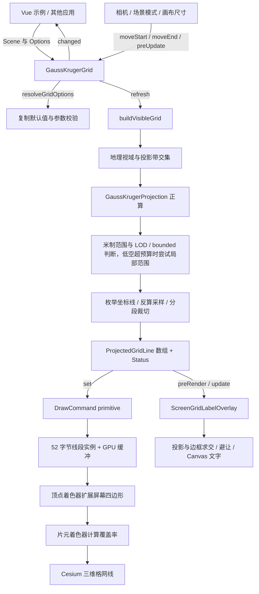
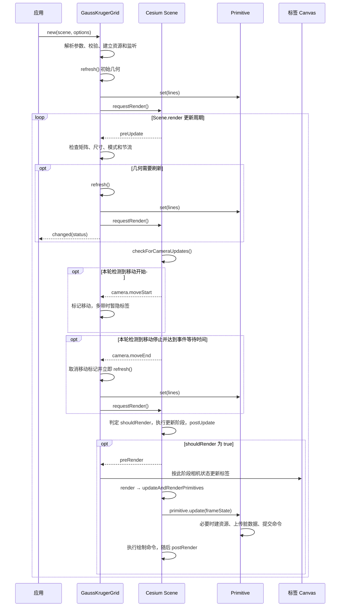

# Cesium 高斯—克吕格方里网：架构与计算流程

本文按当前源码说明“参数和相机状态如何变成屏幕上的线与数字”。使用入口、默认参数对比和安装步骤见[项目介绍](./项目介绍.md)。阅读时可取 6° 第 20 带中的 `E=500000 m` 作为贯穿示例：它位于 117°E 中央经线上，反投影后成为三维地球上的一条折线。

本包的源码、两份学习文档与 [Skill](../skills/cesium-gauss-kruger-grid/SKILL.md)随发布包提供；本文 `../../../src/`、`../../../scripts/` 链接指向完整源码仓库中的示例与验证资料，单独安装发布包时不可用。

## 1. 模块职责与数据流



| 模块                                                                                    | 输入                     | 输出及边界                                     |
| --------------------------------------------------------------------------------------- | ------------------------ | ---------------------------------------------- |
| [types.ts](../src/types.ts)                                                             | 应用配置                 | 可公开的参数和状态约定                         |
| [GaussKrugerGrid.ts](../src/GaussKrugerGrid.ts)                                         | Scene、配置、场景事件    | 组织几何、primitive 和标签，管理生命周期       |
| [gaussKrugerProjection.ts](../src/gaussKrugerProjection.ts)                             | 带号、地理/平面坐标      | 单带正反投影；不参与相机调度                   |
| [gridGeometry.ts](../src/gridGeometry.ts)                                               | Scene、已解析配置        | 可见折线片段与统计状态；不创建 GPU 资源        |
| [DrawCommandGaussKrugerGridPrimitive.ts](../src/DrawCommandGaussKrugerGridPrimitive.ts) | 三维折线片段             | CPU 实例数组、GPU 缓冲和绘制命令；不计算投影带 |
| [screenLabels.ts](../src/screenLabels.ts)                                               | 折线、场景相机、画布大小 | 独立 Canvas2D 标签；不修改几何                 |
| [shader](../src/shader/gridLineVertexShaderSource.vs.glsl)                              | 每段起终点及半线宽       | 屏幕像素宽度的三角形与抗锯齿颜色               |

贯穿各模块的 `ProjectedGridLine` 包含：`axis`、`coordinate`、`zoneNumber`、`isMajor`、`positions`。其中 `axis="easting"` 表示东坐标保持不变、沿北方向采样，并不意味着旋转后的屏幕里它始终竖直。每条对象代表一个连续可见片段，同一带的同一个坐标值可以对应多个片段。

## 2. 投影模型：从经纬度到带内米制坐标

`GaussKrugerProjection` 为每个带建立一个 Proj4js 转换器：

```text
地理：+proj=longlat +ellps=GRS80
投影：+proj=tmerc +lat_0=0 +lon_0=中央经线
      +k=1 +x_0=500000 +y_0=0 +ellps=GRS80 +units=m
```

高斯—克吕格使用椭球横轴墨卡托，保持局部角度关系，距离随位置有投影变形。代码将正算交给 Proj4js；自身负责参数、单位和带号，不另写一套截断级数公式。参数含义可对照 [PROJ 官方说明](https://proj.org/en/stable/operations/projections/tmerc.html)，数组轴序可对照 [Proj4js API](https://proj4js.org/)。

可用符号表示为：

```text
正算：P(经度 λ, 纬度 φ) = (东坐标 E, 北坐标 N)
反算：P⁻¹(E, N) = (λ, φ)
```

`project()` 接收弧度制 `Cartographic`，归一化经度，转成度后调用 `forward()`；`unproject()` 调用 `inverse()`，再返回弧度制 `Cartographic`。高度单独保留，平面投影不计算高度。

中央经线由带号决定：6° 带为 `6z−3` 度，3° 带为 `3z` 度。超过 180° 的中央经线减去 360° 用于显示和转换。`zoneNumberFromLongitude()` 将经度转为周期范围，处理带界附近的浮点噪声后取整，防止恰好处于带界的点误入前一带。

带内东坐标始终以 500,000 m 假东偏表示。带号百万米前缀只属于标签格式，不进入正反算；否则把第 20 带的 `20500000 m` 误当作带内 E 会产生完全不同的结果。

## 3. 计算视域并划分投影带

### 3.1 地理视域

`getVisibleGeographicBounds()` 调用 `camera.computeViewRectangle(WGS84)` 获取当前相机覆盖地球的经纬度包围范围。这个范围是生成几何的包围范围，后续 GPU 仍会做屏幕视锥裁剪。

处理顺序如下：

1. 若取不到地球范围，返回空数组。
2. 若 `east < west`，先把东边界增加一周，得到连续跨度。
3. 按 `viewPadding` 扩大经纬跨度，缓解相机小幅移动时边缘来不及补线。
4. 纬度限制到 80°S～84°N。
5. 若覆盖整周，使用 `[-π, π]`；否则跨反经线的范围拆成两段。

### 3.2 每个投影带的局部范围

自动分带会枚举 6° 的 60 个带，或 3° 的 120 个带；固定带只处理指定带。投影转换器与相机无关，以 `带宽:带号` 缓存，最多保留 128 个。

`createZoneFrames()` 分别尝试经度偏移 `−2π、0、+2π` 后的带范围，再与视域求交。这解决了“地理矩形在反经线断开，而带号在 Greenwich 周期编号”的两种接缝，尤其避免 180° 中央经线的 3° 带丢失半边。

每个 `ZoneFrame` 保存单带投影器、地理交集和投影后的米制范围。各带独立定义自己的坐标网；代码不会把一个完整网格延伸到相邻投影带。

### 3.3 背面范围的早期剔除

`isGeographicFramePotentiallyVisible()` 在生成采样点之前排除确定在背面的整个范围。它在经纬范围内估计单位法线与相机向量点积的最大值，与 WGS84 最小半径比较。

这是保守的早期判断：目的是省去肯定不可见带的投影和采样开销。它没有只检查几个离散角点，因而不会因为角点都在背面而轻易舍弃地平线附近的狭窄可见区域。最终仍对每个采样点执行地平线判断。

## 4. 正算范围、选择间距、枚举坐标线

### 4.1 为什么不能只投影矩形四角

投影是非线性映射，地理矩形边界在平面上通常不是直线，极值可能出现在边中。`projectGeographicBounds()` 组合以下纬度和经度：

```text
纬度：南边界、北边界、夹到范围内的赤道
经度：西边界、东边界、夹到范围内的中央经线
```

共计算 3×3 个候选点，从中确定 E/N 的最小值和最大值。赤道附近的东坐标宽度和中央经线附近的北坐标极值因此得到覆盖，最后在四个方向增加 0.001 m 数值余量，减少精确格线落在边界时的浮点漏选。

这是针对当前窄带横轴墨卡托和纬度范围的实现。更换为其他投影时，不应直接复用这组极值位置假设。

### 4.2 bounded 与 LOD

把各个 frame 的投影宽度求和，得到 `visibleProjectedWidth`；把投影高度取最大值，得到 `visibleProjectedHeight`。这两个量用于密度估计。

`bounded` 直接使用 `gridSpacing`，并检查：

```text
ceil(投影宽度 / 东向格距) + 1 <= maximumLinesPerAxis
ceil(投影高度 / 北向格距) + 1 <= maximumLinesPerAxis
```

满足预算时沿用原来的带余量视域；不满足时调用 `buildLocalZoneFrames()` 尝试低空局部回退。只有相机椭球高度不大于 `gridSpacing × (maximumLinesPerAxis−1) / 2`，且不能确定视锥全部朝天时，才继续尝试。高空超预算仍返回 `undefined`。回退始终保留原格距，只收紧生成范围。

局部窗口以相机经纬度对应的地表点为中心，初始半宽取上述高度门槛的同一个米制值，用 WGS84 最小半径换算纬度跨度，并结合窗口纬度的余弦估算经度跨度。窗口在反经线拆段、限制到支持纬度后，与已经加过 `viewPadding` 的原视域求交，自身不再增加 padding。它是近似的经纬度计算窗口，不是精确视锥边界，也不是严格的圆形距离限制；窗口外远处不生成格网。

每轮重新分带、正算包围范围，再用 `fitsFixedGridBudget()` 检查实际的各带宽度之和与最大高度。若仍超预算，按 `0.98 × min(允许跨度/实际宽度, 允许跨度/实际高度)` 缩小半宽，最多进行 4 轮构建与校验。2% 余量用于吸收投影变化和边界数值余量；局部交集为空或有限轮次仍不满足时返回 `undefined`。通过后仍执行候选线和常规采样点的最终预检，不绕开原有预算。

`isViewAboveSurface()` 只为局部回退提供全天空的保守排除：在相机地表点构造椭球切平面，若四角射线起点均严格处于平面上方、方向均不朝向平面下方，则整个视锥也不能到达该平面下方的地球。只要某角方向朝下、起点条件不满足或取不到射线，就保留尝试。这里不要求中心射线命中地球，也不是用“四角拾取均失败”判断全天空；中心朝天而屏幕下方仍有地表时，不会因此被拒绝。

`lod` 不启用上述局部回退，原有选层逻辑保持不变：先找到 `cameraHeight <= maximumCameraHeight` 的层级，再逐级增大格距，直至满足密度目标或到达最后一个层级。选中的间距用作北坐标间距，东坐标间距为：

```text
eastingGridSpacing = min(northingGridSpacing, maximumEastingSpacing)
```

默认将东坐标间距限制到 500 km，使每带中央经线 `E=500000` 在远景仍有机会保留。最后一个层级不一定满足目标，东向上限也会增加线数，加上各带和裁切片段，最终数量不能用 `maximumLinesPerAxis` 直接推算。

### 4.3 规则坐标线

若格距为 ΔE，则范围内的等东坐标线为：

```text
k_min = ceil(E_min / ΔE)
k_max = floor(E_max / ΔE)
E_k = k × ΔE，k_min <= k <= k_max
```

等北坐标线同理。以 E 范围 `498200～502700 m`、ΔE=`1000 m` 为例，生成 `499000、500000、501000、502000 m` 四条线。格线锚定于坐标整数倍，而不是相机位置，所以移动相机不会让网格原点漂移。

主线依据 `abs(round(coordinate / gridSpacing)) % majorLineEvery === 0` 判断。它强调的是每若干个当前格距的坐标线；LOD 改变间距后，主线的物理间隔也随之改变。

## 5. 将投影直线变成连续的三维片段

### 5.1 采样点的生成

一条投影直线由平面起点 `(E₀,N₀)` 和终点 `(E₁,N₁)` 表示。用参数 `t∈[0,1]` 插值：

```text
E(t) = E₀ + (E₁ − E₀) × t
N(t) = N₀ + (N₁ − N₀) × t
```

每个点反算成经纬度，再加上 `altitude`，交给 `WGS84.cartographicToCartesian()` 得到 ECEF。相邻 ECEF 点之间由直线段连接，从而近似地球表面的投影曲线。

采样段数为 `max(2, ceil(投影长度 / sampleSpacing))`，因此至少生成起点、一个内部点、终点这三个常规采样点。当整条范围短于一个步长时，恰好分成两段并检查中点。这能覆盖“两端在外、但中点在内”的常见漏线情况；若可见区域既不含中点，也没有被其他采样点命中，仍可能漏检。

### 5.2 采样步长为何与格距不同

`gridSpacing` 控制相邻坐标线的间隔；`sampleSpacing` 控制同一条线的折线分辨率。代码还会根据相机高度、画布高度和绘制高度自动估计步长。

近似球面弦高关系为：

```text
弦高 δ ≈ L² / (8R)
因此 L ≈ sqrt(8Rδ)
```

代码取近似曲率半径 `R=6350000 m`，先计算：

```text
chordTolerance = max(0.001, min(0.08,
  cameraHeight / canvasHeight × 0.05,
  altitude × 0.25))
minimumSampleSpacing = min(2000, sqrt(8R × chordTolerance))
maximumSurfaceSampleSpacing = sqrt(8R × altitude × 0.25)
```

然后针对线的延伸方向，取：

```text
实际步长 = min(调用方 sampleSpacing 或无穷大,
               maximumSurfaceSampleSpacing,
               max(minimumSampleSpacing, 另一轴格距 × 0.5))
```

这些是控制视觉曲线和平衡开销的启发式选择。`0.08 m` 参与近景基础步长估算，但随后还有 `max(..., 格距的一半)`，因此不能把它解释为所有折线最终弦高始终小于 8 cm。高度约束用于避免远景长弦沉入椭球，也不构成完整的投影曲线误差证明。自定义 `sampleSpacing` 是进一步收紧步长的上限，过小会触发预算拒绝。

### 5.3 范围与地平线裁切

每个反算点同时满足以下两项才标为 `inside`：

1. `isWithinFrame()`：经纬度在当前带与视域的地理交集内；经度先展开到该 frame 附近，避免 ±180° 判断错误。
2. `isPositionFrontFacing()`：对应椭球表面朝向相机。

地平线计算先把绘制点投到椭球表面，得到表面点 `p` 和外法线 `n`，相机位置为 `c`，检查：

```text
dot(n, c − p) > 0
```

此处使用表面点的可见性，适用于椭球表面的格网逻辑，并非针对高空物体或地形遮挡的通用可见性算法。地形和模型遮挡在 GPU 深度测试阶段另行发生。

### 5.4 为什么需要多个片段

相邻常规采样点的 `inside` 状态变化时，`findBoundaryFraction()` 在这段参数区间中二分搜索边界，最多 32 次，或投影区间长度不大于 `0.01 m` 时停止。返回的是可见侧的边界参数。

从可见变不可见时，补上边界点并结束当前片段；从不可见变可见时，以边界点开始下一个片段。这样一条坐标线离开范围又重新进入时，不会在空隙间连接出错误长弦。

`0.01 m` 只是边界搜索停止阈值，不能视作真实测绘精度。该实现仍属于离散采样和状态转变检测；若某个极窄可见区间完全落在两个不可见采样点之间，单靠这两个点不会发现它。至少一个内部采样点和步长限制改善了常见情况，但不是任意曲线的精确解析裁切。

### 5.5 空结果与统计

没有地理范围、没有投影 frame、bounded 超预算且局部回退不适用或未成功，或最终候选线/采样点预检超限时，`buildVisibleGrid()` 返回 `undefined`。已经建立 frame、但没有整格距线或没有可见片段时，可以返回 `{ lines: [], status }`。

成功采用低空局部 frame 时，`status.rangeLimited=true`；正常使用全视域以及 LOD 时为 `false`。该标志说明生成范围受限，不承诺每个屏幕区域都有覆盖，也不等同于改变了格距。相机移动后按同一流程重算，局部窗口随相机地表位置移动，但格线仍锚定在投影坐标的整数倍上。

`verticalLineCount` 和 `horizontalLineCount` 按最终片段累计；`segmentCount` 是每段 `positions.length−1` 的总和。`drawCommandCount` 对有片段的结果记为 1，否则为 0，表示本包的逻辑命令，不表示 Cesium 完整帧只有一次 GPU draw。

## 6. GPU：从三维线段到屏幕四边形

### 6.1 每段 52 字节的实例布局

primitive 将连续点两两配成线段，并将每段写入 13 个 Float32：

| 字节偏移 | 数据           | Float32 数量     |
| -------- | -------------- | ---------------- |
| 0        | 起点 high.xyz  | 3                |
| 12       | 起点 low.xyz   | 3                |
| 24       | 终点 high.xyz  | 3                |
| 36       | 终点 low.xyz   | 3                |
| 48       | 半线宽，CSS px | 1                |
| 合计     | 每实例步长     | 13 × 4 = 52 字节 |

所有实例共享六个 `corner` 顶点，组成两个三角形。`corner.x` 选择起点或终点，`corner.y` 选择线的左侧或右侧。起终点属性的 `instanceDivisor=1` 表示每个实例换一次；共享模板则对每个顶点读取。

CPU 数组默认容量为 256 段，不够时按二倍扩容；扩容会释放旧 GPU 资源，下次渲染重新创建。容量足够时只重写实例内容并标记 `dataDirty`，下一次 `update()` 上传有效段对应的数组切片。

### 6.2 high/low 与相机相对计算

ECEF 的数值通常达到数百万米，单精度浮点直接存储绝对坐标会损失近景小数细节。代码把每个坐标分量拆为：

```text
high = 向零取整(value / 65536) × 65536
low  = value − high
```

高低位分别保存到 Float32。着色器使用 `czm_translateRelativeToEye(high, low)` 与 `czm_modelViewProjectionRelativeToEye` 完成相机相对变换，减少大数相减导致的抖动。它是在 GPU 单精度条件下提高局部位置稳定性的表达，不是把整个渲染器改成双精度。

### 6.3 先裁近裁剪面，再透视除法

顶点着色器得到起终点裁剪坐标后，用 `z+w` 判断近裁剪面距离。两端都在近面后方时，把整个四边形移到裁剪区外；只有一端越界时，通过线性插值将该端移到近面上。

随后才做 `xy/w` 得到 NDC。若先对相机后方端点透视除法，容易出现符号翻转和跨屏幕的巨大三角形，近面处理正是为了避免这类闪烁。

### 6.4 屏幕空间扩宽

将两端 NDC 差乘视口宽高，得到按屏幕长宽比校正的方向；求单位垂线 `normal`。普通线/主线的半宽来自实例，并乘 `czm_pixelRatio` 转为绘制像素。

```text
expandedHalfWidth = halfWidth + pixelRatio
ndcOffset = normal × 左右符号 × expandedHalfWidth × 2 / viewportSize
clipPosition.xy += ndcOffset × clipPosition.w
```

额外扩展的一个像素倍率用于抗锯齿羽化。乘回 `w` 让偏移在透视除法后仍保持目标屏幕宽度。因此相机缩放改变线在地球上的屏幕位置，但不会让其像米制实体那样随距离缩成极细线。

每段独立形成四边形；当前没有实现完整的折线 join、圆头或圆角端帽。学习扩展线型时，应把这一点与长曲线转折处的视觉结果一起考虑。

### 6.5 片元覆盖率与透视插值

顶点把“带符号的线中心距离”和常数 1 都乘同一个裁剪 `w` 后传出，片元阶段再将两分量相除，抵消透视插值对屏幕距离的扭曲。这样两端深度不同时，抗锯齿测量仍按屏幕宽度进行。

具体推导可以对照 shader 理解。设三角形各顶点的屏幕重心权重为 `λᵢ`，`Σλᵢ=1`，近面裁切后各顶点的裁剪分量为 `wᵢ`，目标屏幕距离为 `dᵢ`。默认 smooth 插值对任意属性 `a` 的结果是：

```text
smooth(a) = (Σ λᵢ × aᵢ / wᵢ) / (Σ λᵢ / wᵢ)
Aᵢ = dᵢ × wᵢ
Bᵢ = wᵢ
smooth(A) / smooth(B) = Σ λᵢ × dᵢ
```

商恢复了屏幕线性插值的距离，而非对距离再做一次透视校正。扩宽操作只改变 `clipPosition.xy`，保留 `w`；同一实例各顶点的 `halfWidth` 相同，因此该常量无需同样处理。这个距离描述当前三角形中的横向线宽，不处理线段端帽、多个折线片段的连接，也不代表到整条地理曲线的三维距离。

片元着色器计算：

```text
feather = max(pixelRatio, 1)
coverage = clamp((halfWidth − abs(lineDistance)) / feather + 0.5, 0, 1)
outputAlpha = color.alpha × coverage
```

渲染状态启用深度测试、关闭深度写入、关闭背面剔除并启用 alpha 混合，提交到 Cesium 透明 pass。深度测试允许地球、地形和已有模型遮挡格网；关闭深度写入避免这层半透明网格污染后续深度。

### 6.6 命令与资源复用

primitive 只在 3D、可见、有线段并处于 render pass 时提交命令。它为全部线段维护一个持久的 `DrawCommand`，并从采样位置计算包围球帮助 Cesium 裁剪。

“一个命令”仅指该 primitive 的提交结构。Cesium 可能根据透明处理、多个视锥或衍生 pass 再执行绘制，不能把它作为整帧 GPU 调用次数或性能保证。

## 7. 标签：坐标语义与屏幕布局分开

### 7.1 独立 Canvas

标签 Canvas 挂到 Cesium canvas 的父元素，使用绝对定位，并同步 Cesium canvas 的尺寸和偏移，`pointer-events: none` 让鼠标继续交给地图。

它的 backing-store 倍率为 `min(4, max(devicePixelRatio, labelPixelRatio))`。绘制时 `setTransform()` 使用这个倍率，布局仍以 CSS 像素进行。文字在 DOM Canvas 上绘制，不经过 WebGL 后处理采样，减少文字被模糊的机会。

### 7.2 投影到边框

每次更新对折线点执行朝向检查和 `worldToWindowCoordinates()`，同一个 `Cartesian3` 对象的结果在本次更新内缓存。相邻屏幕点组成线段，与画布四边求交；最终选择分配给该坐标轴的左边或下边。

边框交点还会在画布内侧轻微偏移后调用 `pickEllipsoid()`，确认对应边缘覆盖地球，避免把投影延长到天空的交点当成有效注记位置。它检查椭球，不等同于复杂三维模型遮挡判断。

### 7.3 轴向交换和稳定抽稀

代码统计两组线在屏幕中的水平与垂直行进量，估计谁更竖直：更竖直的一组放在下边，另一组放在左边。差异小于 `0.12` 时保留上次分配，形成滞回，减少旋转到约 45° 时边缘来回跳动。

抽稀先按屏幕位置排序，取相邻间隔的中位数估计需要跳过多少条；再按投影坐标索引取模，使被选标签随相机移动更稳定。最后按屏幕距离再检查一次，并为角落和底部控件预留区域。底边还将实际文字宽度纳入间隔。

因此标签数量不等于线数，且屏幕布局会随相机方向改变。这里的 `minimumLabelSpacing` 是布局输入，末轮容差采用其 `0.85` 倍，不应描述为所有标签间距严格不少于该数值。

### 7.4 数字分组

`formatGridCoordinate()` 返回包含 X/Y 和 km 的完整文本。实际 Canvas 使用同一数值格式，再将公里整数部分分成高位与最后两位：高位小字略上抬，末两位大字，负号与小数保持。

先绘制所有字形描边，再统一填充，避免后绘制字片段的描边覆盖前一片段。文字宽度以“字体+文本”为键缓存，最多 1,024 项，超过后清空。

## 8. 事件顺序与按需渲染



以上顺序已对照本仓库锁定的 `@cesium/engine@26.1.0` 中 `Scene.js` 与 `View.js`。普通 3D render pass 的关键调用链是 `preRender → render() → updateAndExecuteCommands() → executeCommandsInViewport() → updateAndRenderPrimitives() → scene.primitives.update()`，所以本包标签回调在这一轮普通 primitive 更新之前执行。`moveStart/moveEnd` 由相机检查触发，不是固定紧挨在绘制前后各触发一次；`moveEnd` 还受 Cesium 的 `cameraEventWaitTime` 控制。

图中省略了预加载、拾取、阴影、多视锥和后处理等阶段，不应据此把任意一次 `preUpdate` 当作都会执行 GPU 绘制，也不应推广为所有特殊 pass 的完整时序。Scene 事件与 `requestRender()` 的定义可见 [Cesium Scene 文档](https://cesium.com/learn/cesiumjs/ref-doc/Scene.html)。

两个矩阵快照组分别记录“上次几何重建状态”和“上次标签绘制状态”。这允许相机移动时标签比昂贵的几何生成更频繁更新。只比较相机位置不够，投影矩阵变化也可能来自视场角调整，所以视图矩阵和投影矩阵都参与比较。

`preUpdate` 负责发现变化，即使 `requestRenderMode` 跳过本帧绘制，更新阶段仍有机会发起下一帧请求。尺寸或场景模式变化立即刷新；其他相机变化按几何间隔节流。若几何尚不需要刷新，但标签状态脏或视图变化到达标签间隔，也会请求渲染。

`preRender` 在实际渲染阶段更新标签，以此时相机矩阵做屏幕投影。默认几何间隔 80 ms、标签间隔 32 ms；可见带数达到 4 时，几何间隔至少 250 ms，且移动中隐藏标签，停止后重建并恢复。阈值依据当前已记录状态的带数，不是每帧另算一次全球带数。

`show=false` 隐藏线与文字并停止自动更新，保留旧状态；设回 `true` 会立即刷新。`changed` 在有效构建后抛出；清除时只有此前存在状态才发出 `undefined`，避免重复空状态通知。构造时已经初算，所以应用应先读取 `status`，再监听后续变化。

## 9. 资源所有权与销毁

| 资源                                         | 创建者/拥有者            | 释放方式                                   |
| -------------------------------------------- | ------------------------ | ------------------------------------------ |
| Viewer / Scene / 底图                        | 应用                     | 应用负责销毁，格网不代管                   |
| 格网 primitive                               | `GaussKrugerGrid`        | 从 `scene.primitives` 移除，必要时显式销毁 |
| CPU 实例数组                                 | primitive                | 销毁时换为空数组；扩容时替换旧数组         |
| 顶点/实例 Buffer、VertexArray、ShaderProgram | primitive                | `releaseResources()`                       |
| RenderState 缓存引用                         | primitive                | `removeFromCache()`                        |
| 标签 Canvas 与标签缓存                       | `ScreenGridLabelOverlay` | 移除 DOM 元素并清空缓存                    |
| 四个相机/场景监听                            | `GaussKrugerGrid`        | 调用注册时取得的移除函数                   |
| 应用对 `changed` 的监听                      | 应用                     | 调用 `addEventListener()` 返回的移除函数   |

`destroy()` 可重复调用。若 Scene 仍存在，先从 primitive 集合移除；集合可能配置 `destroyPrimitives=false`，所以之后再检查 primitive 是否已经销毁，必要时补充显式销毁。若应用先销毁了 Viewer，图层也会避免继续访问已销毁的 Scene。集合行为可参考 [Cesium PrimitiveCollection](https://cesium.com/learn/cesiumjs/ref-doc/PrimitiveCollection.html)。

VertexArray 通常拥有挂接缓冲。释放逻辑逐项检查 `isDestroyed()`，既避免二次释放，也覆盖资源初始化中途失败、缓冲还未被 VertexArray 接管的情况。`createResources()` 失败会清理已创建部分；构造中的初次 `refresh()` 失败也会回收该图层已经建立的资源。

## 10. 性能预算与统计解释

在进入坐标线的常规采样循环之前，几何层按各 frame 的候选线数和分段数估算工作量：候选线总数超过 8,192，或候选常规采样点估算超过 500,000，或估算非有限数，就返回 `undefined`。这项最终预检对低空局部回退和 LOD 同样生效；局部范围通过固定格距跨度预算，并不代表任意采样密度都能通过。

这里的 500,000 不是所有投影调用的绝对上限。投影范围正算、地平线检查、边界二分等都有额外计算，边界二分还会生成额外端点。这个预算的作用是快速拒绝极小采样步长或极密格距，而不是精确计算每帧耗时。

主要优化按阶段分工：

| 阶段     | 已有策略                                 | 仍需留意                                                |
| -------- | ---------------------------------------- | ------------------------------------------------------- |
| 投影准备 | 有限缓存转换器                           | 切换 3°/6° 并累计访问超过 128 个带宽/带号组合时会有替换 |
| 几何生成 | 背面范围早剔除、只生成视域、预算预检     | 当前为主线程同步计算，复杂视域仍有成本                  |
| 相机更新 | 几何/标签分开节流，大视野降低频率        | 快速移动中几何可能短暂沿用上次结果                      |
| GPU      | 实例化、持久命令、容量二倍增长、按脏上传 | 几何重建仍会打包当前所有段，非局部增量                  |
| 标签     | 点投影复用、文字宽度缓存、坐标稳定抽稀   | 每次更新仍有候选生成、排序和绘制开销                    |

52 字节乘线段数只能估算实例数据的有效字节量。实际容量可能更大，还存在 CPU 对象、采样点数组、标签 Canvas、驱动和 Cesium 本身的资源，不能当作总显存或总内存。

## 11. 验证分层与扩展方式

验证应从数学到画面逐层进行。下表入口均位于完整源码仓库，根项目的测试脚本、数据和 Vue 示例不随独立发布包提供：

| 层次          | 仓库入口                                                                                                                                                | 目的                                                          |
| ------------- | ------------------------------------------------------------------------------------------------------------------------------------------------------- | ------------------------------------------------------------- |
| 独立投影参考  | [grid-projection-reference.json](../../../scripts/grid-projection-reference.json) 与 [生成脚本](../../../scripts/generate-grid-projection-reference.py) | 使用 pyproj/PROJ EPSG 数据库生成参考，避免用被测 Proj4js 自证 |
| 投影/API 检查 | [grid-projection-check.mjs](../../../scripts/grid-projection-check.mjs)                                                                                 | 正反算、带界、参数拒绝、完整标签格式                          |
| 几何检查      | [grid-geometry-check.mjs](../../../scripts/grid-geometry-check.mjs)                                                                                     | 分裂片段、赤道极值、反经线、近景中点、复制配置、预算快速拒绝  |
| 浏览器回归    | [grid-regression.html](../../../scripts/grid-regression.html) 与 [脚本](../../../scripts/grid-regression.mjs)                                           | 真实 Cesium/WebGL、视场角、按需渲染、模式与销毁               |
| 示例交互      | [index.vue](../../../src/examples/primitive/square-kilometer-grid/index.vue)                                                                            | 人眼确认线宽、标签、控制交互、导航清理和控制台                |

数值回归的毫米级比较阈值用于检测投影实现是否回退，不等于真实坐标数据的绝对精度。静态截图也不能替代按需渲染、相机移动和资源清理验证。

常见扩展应落在明确的边界：

- **新的坐标参考系**：先改投影定义与独立控制点，再重新证明范围极值、带界和有效纬度假设；仅换椭球名不足以完成基准转换。
- **自定义折线数据**：可直接使用导出的 `DrawCommandGaussKrugerGridPrimitive` 与 `ProjectedGridLine`，调用方负责相机更新、可见性、几何有效性和清理。
- **新的标签样式**：修改 `screenLabels.ts`，保持计算坐标与显示格式分离；如需显示轴前缀/单位、字体配置或更多边缘，需要扩展现有接口。
- **贴地格网**：需要新增异步地形高度采样、缓存和失效策略，不能简单把 `altitude` 改成 0。
- **Worker 几何计算**：需要先把 Scene 相关信息提取为可序列化快照，再分离几何计算和 Cesium 对象构造；现实现不直接支持把整个 Scene 发送给 Worker。
- **2D 或 Columbus View**：必须重新设计坐标转换、地平线判断和着色器位置来源，当前通过隐藏保护 3D 假设。
- **Cesium 升级**：重点验证内部渲染接口、实例属性、shader 内置函数、透明 pass 和销毁行为，不能只以 TypeScript 编译通过作为兼容依据。

从零重建这套功能时，推荐先完成一个固定带的正反算控制点，再实现固定间距与 ECEF 折线，接着加入视域和裁切，之后接入 GPU 实例绘制、标签、自动分带与 LOD，最后完善事件节流、预算、清理和独立包导出。每一步都能在前一层已验证的前提下缩小问题范围。
