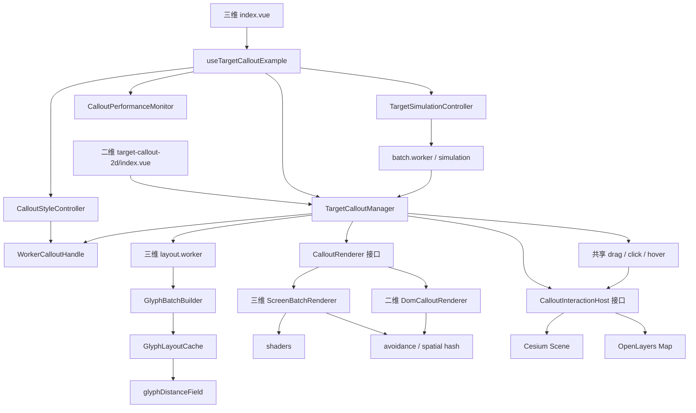

# 标牌工具架构文档

## 分层与依赖

示例代码从包名 cesium-screen-callout 导入；包内不反向依赖示例。classification 是示例业务模型，字体分类和属方名称不进入通用渲染层。

管理器构造参数使用 `TargetCalloutSharedOptions & ({ scene; map?: never } | { map; scene?: never })`，从入口保证宿主二选一。两种分支共用句柄、输入校验、合并队列、持续覆写、字段处理和事件回调；渲染资源与投影由各自后端实现。OpenLayers 10.11 是外部 peer dependency，二维分支不启动布局 Worker，也不创建标牌 GPU 资源。

## 文件与职责

| 文件 | 内容 |
| --- | --- |
| 示例 index.vue | 展示控件、绑定响应式状态和事件 |
| 示例 index.vue 中的 scoped style | 页面布局、控件外观 |
| 示例 useTargetCalloutExample.ts | Vue 状态、Viewer 初始化、相机操作、服务生命周期编排 |
| 二维示例 target-callout-2d/index.vue | OpenLayers 本地静态底图、同结构模拟数据、控制面板与地图生命周期 |
| 示例 CalloutStyleController.ts | detailed / compact / title 三套平台/属方批量更新、恢复分类样式 |
| 示例 TargetSimulationController.ts | 模拟时间、暂停恢复、Worker 请求节流与销毁 |
| 示例 CalloutPerformanceMonitor.ts | rAF 采样、长任务监听、JSON 导出 |
| 包 TargetCalloutManager.ts | 统一入口、宿主分支、校验与任务合并、回收缓冲、资源所有权 |
| 包 rendererInterface.ts | 两种渲染器共有的配置、统计和销毁接口 |
| 包 interactionHost.ts | 宿主元素、请求绘制、帧前更新、临时暂停输入及事件归属接口 |
| 包 layout.worker.ts | 应用数据与覆盖项、脏标记、线程消息边界 |
| 包 GlyphLayoutCache.ts | 字形图集分配、SDF 栅格化、逐行宽度缓存 |
| 包 glyphBatch.ts | 生成背景/边框/牵引线/文字的实例数据 |
| 包 presentationLayout.ts | 二三维共享标题、正文、方块和按钮预留区域的几何布局 |
| 包 screenBatchRenderer.ts | GPU 资源、逐帧投影、实例上传与绘制命令 |
| 包 domRenderer.ts | ECEF 到地图投影、DOM 内容/测量、transform、独立模式避让 |
| 包 shaders.ts | GLSL 顶点变换和片元 SDF 抗锯齿 |
| 包 workerHandle.ts | 轻量状态、屏幕固定、中心距离约束、拾取 |
| 包 display.ts | 简详标显示模式、三样式区域、标题取值、简标单行文本与默认样式 |
| 包 drag.ts / click.ts / hover.ts | 共享指针交互、拖动抑制点击、双击切换、输入恢复和详标工具栏 |

## 数据更新与视图更新

业务路径：模拟 Worker 返回 ECEF 位置和文字 → 主线程管理器合并输入 → 布局 Worker 更新状态 → 按需生成实例 → 主线程上传。文字/样式未变时，返回 unchanged 标志，只更新位置和显隐，保留 GPU 字符缓冲。

相机路径：Cesium primitive.update → 当前相机投影与遮挡判断 → 更新目标参数纹理、中心距离约束及命中区域 → 提交牵引线和标牌命令。这条路径不等待业务 Worker，暂停业务后仍可平移、缩放和拖拽。

二维数据路径：相同 ECEF / titles / badges / lines / fields 输入 → 管理器微任务合并 → DomCalloutRenderer 应用源数据与覆写 → 统一写入脏标牌内容及样式 → 统一测量文字并应用共享布局 → 提交模式与命中区域。标题、方块字母与正文均用 textContent 写入，不作为 HTML 解释。位置更新不重建未变化的行 DOM；经纬度转换按位置版本和 View 投影缓存。

二维视图路径：OpenLayers postrender → ECEF 对应的地图坐标 → 按视图中心选择最近世界副本 → map.getPixelFromCoordinate → 距离约束、避让及句柄命中区域 → CSS transform。getUserProjection 非空时在 View 投影与用户投影间转换，避免重复投影。高程不参与二维屏幕投影。顶层 overlay 挂在 map.getViewport 内，先放目标点与牵引线，再放标牌面板；地图更新不会等待业务数据。

两种管理器后端的视口显隐同时检查锚点与偏移后的标牌矩形。锚点已出屏但面板仍与视口相交时继续显示，只有两者都离开视口才按离屏隐藏；这也适用于固定在屏幕内的面板。三维仍独立应用相机前后关系、椭球遮挡及原有深度测试，二维不增加三维遮挡判断。

启用避让时，投影之后检查屏幕矩形碰撞，仅在发生标牌碰撞（含配置间距）时修复，再把统一的显示偏移写入句柄、GPU 参数纹理或 DOM transform。avoidance.ts 从前帧相对偏移继续，以空间哈希查询接触矩形。精确候选、候选队列和整批最佳结果依次比较与本次释放标牌的冲突、总重叠、移动标牌数和移动代价，尽量只移动冲突中的必要一侧。拖拽期间暂停整批避让，邻居保留已有避让偏移，松手后才按最终位置重算；历史拖拽优先级只影响移动偏好，不抵消碰撞。局部候选入队去重，超密集场景在占用密度积分表搜索前后各执行一次有预算的精确局部修复，每轮限制 16 个候选和 32 张邻居，各阶段共享候选预算，最终仍按真实矩形统计冲突。WorkerCalloutHandle 分开保存配置偏移和显示偏移，避免自动布局污染用户设置；布局预算耗尽时保留全部目标。

默认局部策略用 `maxDisplacement: 160` 限制相对各自配置位置的自动位移。`distanceWeight: 0.25` 调节靠近配置位置的移动代价权重；精确修复先比较碰撞结果与移动数量，不能用距离或优先级代价换取保留碰撞。该权重为 0 时仍考虑相对本次修复起点的移动距离。密度阶段使用占用密度与移动代价的能量权衡，避免为微小的近似收益大幅移动；它不把密度估计当作精确重叠面积。矩形投影、候选修复和密度退化均服从该半径；已无冲突的标牌在障碍移走后保留位置，不自动回位，以减少再次移动。手动拖拽的位置不受自动半径限制，其他标牌无法在附近完全让开时允许保留冲突。整个求解器是有限预算的二维启发式，不是完整 VPSC 或全局最优装箱实现。

视口不再是全局位置约束。没有碰撞时直接沿用相对偏移，地图变化可以使面板越界，不执行视口投影或边界钳制。本次碰撞修复开始前，以当前投影和已有偏移构成的完整矩形判断保护范围：当时完整在屏内的标牌，其修复候选必须仍完整在屏内；已经越界的标牌不因此被拉回。保护判定固定于本次修复的起点，不能用上一帧在屏内的状态阻止正常地图移动，也不能在迭代过程中以已移动矩形重新定义保护范围。所有碰撞修复路径，包括密度退化，都遵守这一条件；无可行候选时保留冲突。

同一次布局调用可在预算内迭代，但最终偏移直接提交给 GPU / DOM 和命中区域，不做插值、CSS 过渡或逐帧限速位移。最大中心距离等显式配置仍由句柄约束，不与“无碰撞时避让器不主动移动”的规则混为一谈。

管理器的 `preservePositionOnAvoidanceDisable` 默认开启。某组避让从开启切换为关闭时，管理器先按当前已渲染模式选出受影响句柄，将显示偏移保存为首选配置偏移，再关闭该组布局；全局关闭同时处理两组。设置为 `false` 时保留原有配置偏移，由低层 Renderer 恢复配置位置。这些屏幕状态更新无需 Worker 重新布局。

每个句柄分别保存 detailed 正文、compact 简标和 title 标题三套样式。详标显示独立 title 和多行 lines，简标将 fields 经主线程处理函数转换为单行值文本；title 也可取自 key 为 title 的字段，同批显式 titles 优先。badgeText 是各目标独立的大写字母，在详标标题和简标左侧显示；方块颜色来自相应样式。三维与二维共享 presentationLayout 的标题、正文、方块及按钮预留区域几何，整张详标矩形包含所有区域。三维模式、尺寸与按钮区域随 Worker 批次提交；二维在 DOM 更新和测量后提交。Renderer 仍只按已应用显示模式分成简标和详标两个避让组，标题不是第三个组。双击由共享 ClickController 在宿主元素上拾取并切换，随后触发 onDoubleClick；销毁时释放监听。

共享悬停控制器继续拾取简标和详标并触发事件，仅在请求模式与已渲染模式均为详标时，在已提交的标题按钮区域显示固定、关闭小圆按钮，模式切换等待 Worker 期间也不在简标旁显示工具栏。标题与正文的字号变化同步更新总包围盒和按钮区域，避免工具栏覆盖标题或滞后于当前命中范围。

纯屏幕偏移不发送 Worker 消息；数据与交互变化通过宿主调用 scene.requestRender 或 map.render，兼容按需渲染。三维包围球按数据批次更新，逐帧相机计算复用。即使全透明样式产生零实例或透明 DOM，也继续更新面板尺寸、位置和命中区域。

交互控制器只依赖 CalloutInteractionHost 与句柄。Cesium 通过 enableInputs 保存/恢复相机输入，OpenLayers 保存当前启用的 interactions，拖拽结束后恢复仍属于地图的这些对象；地图控件和其他覆盖层通过 ownsEventTarget 排除。两种模式共用 onSelect、onClick、onDoubleClick、onDragEnd 与 onHover；拖动超过阈值不再产生标牌点击。

## 缓存约束

GlyphLayoutCache 保留固定图集与每目标当前行缓存。相同字体、相同文本行复用字形引用和宽度；新字符增量加入图集。图集满且有旧字符时清理并重排，同时失效逐行缓存，避免引用旧 UV。GlyphBatchBuilder 复用字形 UV 数组与最多 256 项颜色解析缓存。

二维缓存当前文本、样式、尺寸、投影结果与 transform，只对脏内容进行 DOM 测量，监听 document.fonts 的 loadingdone 使新字体测量失效。SDF smoothing / weight 在二维仅保存供统一 API 查询，不改变浏览器字体渲染；pixelSnap 可在不影响拖拽及有限距离约束时对齐面板。

## 资源释放

页面卸载先停止模拟调度，再销毁管理器，移除 postRender 监听，停止性能监控，恢复画质配置，最后销毁 Viewer。管理器终止布局 Worker、销毁交互控制器和批量渲染器。异步初始化在 await 后检查 disposed，防止页面离开后重启调度。

二维页面先停止 RAF 数据调度并销毁管理器，随后由页面调用 map.setTarget(undefined) 和 map.dispose。DOM 后端注销地图及字体监听、移除顶层 overlay、清空避让缓存；共享交互控制器移除指针和窗口监听、恢复拖拽前的地图输入。管理器绝不销毁外部 Map 或 Scene。二维同样遵守 transfer=true 的位置缓冲所有权约定，在应用时用可转移 structuredClone 分离输入缓冲。

构造失败会回滚已创建的 Renderer/Worker；运行错误进入终止状态，解除消息回调、拒绝 ready/flush、释放资源后通知业务。销毁拖拽控制器恢复相机输入，但不再触发业务 onDragEnd。示例初始化失败也立即走统一 cleanup。

旧路径 src/cesium/tools/target-callout 保留兼容转发；旧 renderer.worker 和 simulation.worker 用于已有回归页面，不属于当前业务示例的默认运行链路。
